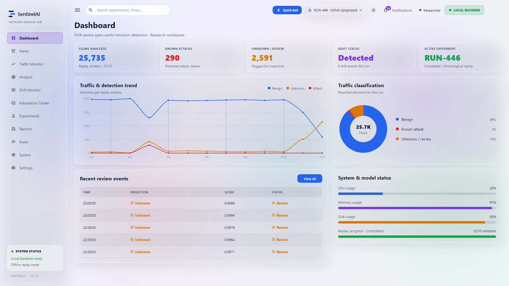
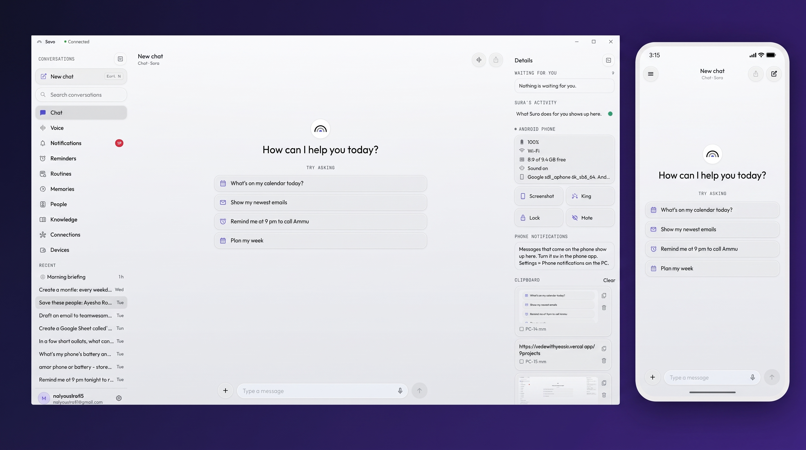

# Md. Yeasir Arafat

**Software &amp; AI Engineer** — Flutter · Machine Learning · AI Automation

Computer Science &amp; Engineering, Green University of Bangladesh

---

## About Me

I build **cross-platform mobile applications** and the **intelligence that runs behind them** — from Flutter frontends and FastAPI backends to trained ML models and LLM-driven automation pipelines.

- 🎓 **BSc in Computer Science &amp; Engineering** — Green University of Bangladesh, 2022 – 2026 *(final semester)*
- 📱 **Flutter** developer — responsive UI, BLoC / Riverpod / GetX, offline-first local databases
- 🧠 **Machine Learning &amp; AI** — I own the model end to end: data curation, leakage audits, training and fine-tuning in PyTorch and TensorFlow, calibration, then deployment — quantized on-device or served behind an API the app actually calls
- ⚙️ **AI automation with n8n** — multi-agent workflows: LLM-based intent routing, tool-calling against any REST API, webhook and scheduled triggers, persistent memory, and provider-agnostic model selection — with validation, retries and structured logging on every action
- 🔎 **Retrieval systems** — bilingual RAG over real documents: hybrid dense + lexical search on pgvector, reciprocal rank fusion, reranking, page-level citations, and a score floor that refuses rather than inventing an answer
- 🌍 I build for **hard constraints** — bilingual interfaces, offline-first data, low-end devices, and models validated on the people who actually use them. **Open to remote work worldwide**
- 🔐 Also work across **cybersecurity**, **data mining**, and **embedded / microcontroller** systems
- 💬 Ask me about Flutter architecture, model calibration, or wiring an LLM into a mobile app

 

## Tech Stack

**Languages**

**Mobile &amp; Frontend**

**Machine Learning &amp; AI**

*Custom datasets · leakage audits · probability calibration · quantization for on-device inference*

**LLM &amp; Retrieval**

*Hybrid dense + lexical retrieval · reciprocal rank fusion · reranking · cross-lingual embeddings · grounded answers with page-level citations*

**APIs &amp; Protocols**

**Backend &amp; Data**

**Design &amp; Tools**

---

## Featured Projects

### 🛡️ SentinelAI — Intrusion Detection Under Drift and Unseen Attacks

`Python` `FastAPI` `scikit-learn` `LightGBM` `PyTorch` `Flutter`

Intrusion detectors are trained once, then meet traffic that drifts and attack types that did not exist at training time — while analysts can label only a small, late fraction of the flows. SentinelAI is a research platform for exactly that setting: it replays **CIC-IDS2017, CSE-CIC-IDS2018 and UNSW-NB15 in time order**, lets a detector adapt on a fixed, delayed label budget, and shows window by window what happened — detections, unknown attacks, drift, model updates and false alarms.

**What it does**

| | |
|---|---|
| Open-world detection | Flows far from every known class are flagged *unknown* instead of being forced into a wrong label |
| Drift monitoring | KS-test and confidence-drop detectors, with the reference window moved forward after each accepted update |
| Guarded adaptation | Every candidate model must pass a hold-out check before it is deployed; otherwise it is rejected or rolled back |
| Reproducible experiments | 9 methods, including re-implementations of published baselines · **339 runs** over 3 datasets × 5 seeds · config hash and dataset SHA-256 stored with every run |

**Engineering** — FastAPI + SQLite backend with replay workers and GPU training · Flutter Windows desktop app with 11 pages in light and dark frosted-glass themes · per-user Windows installer, and the app starts and stops its own backend · **94 backend tests, 11 Flutter tests**.

*Status: complete. A conference paper on the adaptation method is being prepared for a double-blind venue, so the repository stays private until the review ends.*

---

### 🔎 Bulletin — Bilingual Document Retrieval for Universities

`FastAPI` `PostgreSQL/pgvector` `Flutter` `RAG`

An institution publishes its academic calendar, exam routines, fee schedules and notices once. Students and teachers ask in **English or Bangla** — optionally attaching their own class routine — and get answers grounded strictly in those documents, **with the page to prove every one**.

**The problem** — language mismatch between question and source is a *silent* retrieval failure. Hybrid search fuses a dense arm with a lexical arm; an English query and a Bangla chunk share **zero tokens**, so the lexical arm returns empty and search quietly collapses to dense alone — precisely where dense is least reliable, because Bangla PDFs in this region often use legacy ASCII-mapped fonts that extract as garbage. No exception, no warning, just a confident "not found."

Two mitigations are implemented and measured against each other: a shared cross-lingual embedding space, and query translation that buys the lexical arm back for one round trip.

**What has actually been measured**

| | |
|---|---|
| Cross-lingual top-1 rank accuracy (20 domain pairs) | **100%**, cosine margin **+0.386** |
| Hybrid ablation | dense owns prose (MRR 0.98) · lexical owns course codes (0.94) · only the fusion never loses a document |
| Gold set, 62 questions | **15/15** unanswerable refused · **0** answers invented a fact |
| Tests | 363 backend · 35 Flutter |

**Correctness enforced structurally, not by convention**

- **The audience filter lives in the SQL, not in post-processing.** Post-filtering leaks through the not-found boundary — a student learns a teacher-scoped document exists from the shape of the refusal. A test asserts the `WHERE` clause precedes the `ORDER BY`.
- **Chat attachments never enter the vector index.** The `attachments` table has no embedding column, so one student's personal routine can never be retrieved for another student's query.
- **Below the retrieval score floor, the LLM is never called.** The plan returned in that case carries no messages — there is nothing to send.

*Status: in progress. Backend pipeline, retrieval and streaming are complete and tested; the comparative ablation that would settle which mitigation wins is blocked on a real bilingual corpus — and the repo says so rather than hiding it.*

🔗 [Repository](https://github.com/Art3MasA005/Bulletin)

---

### 🩺 DiaVision — Diabetes Risk Screening

`Python` `FastAPI` `PostgreSQL` `Flutter` `ONNX`

Eleven questions, no blood test, about two minutes — and back comes a **calibrated risk range** for undetected high blood sugar, plus the two or three things a person can actually change. English and Bangla. Bangladesh-first, built as a localisation engine.

**Model results**

| Metric | Value |
|---|---|
| AUC-ROC | **0.810** |
| Sensitivity / specificity at shipped threshold | **85.1% / 66.9%** |
| Expected calibration error | **0.020** |

**Two decisions worth reading about**

- **I rejected a 0.94 AUC model.** Three extra features would have lifted the headline from 0.806 to 0.9365 — and made it *0.18 AUC worse* on people who have never been screened, which is exactly who the product is for. Leakage audit, documented.
- **Waist beat volume.** Training on 5,843 NHANES rows (89% waist circumference) beat 437,000 pooled rows (1.2%) on the metric that mattered — 66.9% vs 52.9% specificity at 85% sensitivity.

**Engineering** — FastAPI + PostgreSQL with alembic migrations and row-level security · Flutter client with 19 screens in EN + BN, light + dark · **143 backend tests, 55 Flutter tests, 28 screen goldens** · feature contract frozen in `feature_spec.json` before the schema was written against it · three unfinished features say so on screen rather than faking it.

> Not a medical device. It does not diagnose or treat anything and has been reviewed by no medical regulator.

🔗 [Repository](https://github.com/Art3MasA005/DiaVision)

---

### 🤖 Sora — Self-Hosted Personal AI Assistant

`Python` `FastAPI` `Flutter` `PostgreSQL` `pgvector` `Android` `Windows`

A **full-stack, self-hosted AI assistant** that runs on a personal Windows PC and an Android phone simultaneously. Talk to it by text or voice, in English, Bangla or a mix of both — it controls both devices, automates Google Workspace, remembers people and facts, runs routines on its own, and asks before doing anything risky.

**What it does**

| Capability | Detail |
|---|---|
| **Google Workspace** | Read, search, draft and send Gmail · manage Calendar · create Docs, Sheets, Slides · find Drive files · keep a Tasks list |
| **PC control** | Open apps, browse the web, read and write files, run VS Code tasks, take and crop screenshots, control the clipboard |
| **Phone control** | Make calls and send texts by contact name, ring the phone, lock the screen, take a screenshot and beam it to the PC |
| **Routines** | Plain-language triggers: a schedule, an incoming email, a low battery, a web-page change, or a WhatsApp message |
| **Memory** | Stores people (relation, nickname, number, birthday) and facts, recalled automatically by name |
| **Voice** | Custom-trained "Hey Sora" wake word in the owner's accent · Whisper STT · Edge TTS · corner orb on the PC |
| **Approval-first** | Sends, deletes and shutdowns always show the full action and wait — never executes silently |
| **Cross-device** | Shared clipboard, phone notifications mirrored to the PC as Windows toasts, phone battery and storage visible in the sidebar |

**Engineering decisions worth reading about**

- **One LLM loop, two devices.** The agent runs on the PC but can ask the phone to act, and vice versa, over a persistent WebSocket with per-device revocable tokens. The device that owns the action executes it; the other gets the result.
- **Approval cards are structural, not advisory.** Risky tool calls return an `awaiting_approval` response that the client renders as a blocking card — the tool cannot continue until the owner taps Approve or Reject, even if the LLM tries to call it again.
- **"Hey Sora" trained on the owner's voice.** The wake-word model is a small ONNX binary trained on recordings in the owner's Bangla-accented English, so it fires reliably in the owner's accent and not on similar English words said by others.
- **Bilingual end to end.** Every screen, label, error and AI reply is in English or Bangla, switchable at runtime — including the Flutter app on both Android and Windows and every string in the FastAPI backend.
- **Self-hosted and secret-safe.** All data stays on the owner's machine. Google OAuth tokens are Fernet-encrypted at rest. A gitleaks pre-commit hook blocks any commit that contains a key.

**Stack** — FastAPI + PostgreSQL/pgvector backend · Flutter for Android and Windows · Java Android accessibility service for the background phone link · Python PC agent (keyboard, mouse, files, browser, VS Code) · custom ONNX wake-word model · OpenAI-compatible LLM interface (any provider)

🔗 [Repository](https://github.com/Art3MasA005/sora-assistant)
---

### 🌾 Crop Doctor BD — On-Device Plant Disease Detection

`Python` `TensorFlow Lite` `Flutter`

Offline plant disease classification for Bangladeshi crops — rice, potato, tomato and corn across **18 classes**, running entirely on-device with no network at inference.

Most plant-disease projects report 99% on PlantVillage and stop. That number is an artefact — those are single leaves on uniform lab backgrounds, and such models routinely collapse on a real photo taken in a field. **This project treats that gap as the actual problem:**

| | Typical approach | This project |
|---|---|---|
| Test data | Random split of lab images | Separate held-out **field** test set |
| Reported metric | One aggregate accuracy | Lab **and** field, plus per-crop |
| Duplicates | Ignored | Perceptual-hash grouped, leakage asserted |
| Unknown input | Confidently misdiagnosed | `not_a_leaf` / `other_plant` classes + abstain threshold |
| Deployment | `model.h5` in the repo | INT8 TFLite, benchmarked for size and latency |
| Explainability | None | Grad-CAM overlays, including failure cases |

*Status: ML pipeline complete and verified end-to-end; Flutter client in progress.*

🔗 [Repository](https://github.com/Art3MasA005/crop-doctor-bd)

---

### 📒 Ledgerly — Small Business Ledger for Bangladesh (v2.0.1)

`Flutter` `Riverpod 3` `Drift/SQLite` `Firebase Auth` `Cloud Firestore` `Cloud Functions`

A shopkeeper's credit book (*baki khata*) on the phone. Customers and suppliers, who owes whom, daily cash, invoices and stock — in **Bangla or English**, and fully usable with **no internet connection**. Every entry is written to a local SQLite database first; the cloud is a backup, never a dependency.

  
  
  
  
  

**What it does**

| | |
|---|---|
| Customer & supplier ledger | Running balance per party, cash sales, photo of the paper receipt, built-in calculator keypad |
| Cashbox | Daily in/out by category, and reconciliation against the cash actually in the drawer |
| Invoices & statements | Itemised invoices and party statements as A4 PDFs with one shared branded header, ready to share |
| Stock, notes, analytics | Stock in/out per product, business notes, and growth charts drawn with `CustomPainter` |
| Multi-business | Several shops in one account, each with its own isolated books |
| Bilingual | Every screen, amount and date in Bangla or English, switchable at any time |

**Problems worth reading about**

- **A backup that silently stopped working.** A Firestore document is capped at 1 MiB, so a single-document backup works in testing and then quietly stops uploading once a real shop's ledger grows. Backups are now gzip-compressed JSON split into sub-1 MB parts, with photos chunked the same way.
- **"Couldn't read the cloud" is not "there is no backup."** Treating a network error as an empty cloud starts a blank ledger that then overwrites the real one. Read failures are thrown, never defaulted, and every backup carries an id, so a phone refuses to upload over a backup written by another phone it hasn't seen yet.
- **Two phones, one account, no ping-pong.** A restore fires the same database-change events as a user edit; without suppression, two phones would keep re-uploading each other's data. Restores are fenced off from the auto-backup trigger.
- **Shared phones can't leak data.** The local database records which account owns it, and the local backup file is scoped to the signed-in account, so signing in as someone else never surfaces the previous user's books.

**Engineering** — feature-first structure across 12 modules · Drift schema v8 with migrations · per-user Firestore security rules.

*Status: v2.0.1 is preparing for its first Google Play release; the repository still holds the earlier v1 snapshot until then.*

🔗 [Repository](https://github.com/Art3MasA005/Ledgerly-Business-Finance-Manager)

---

### 🔐 SafeText — AES &amp; RSA Secure Messaging

`Cryptography` `Cybersecurity`

Hybrid encryption tool combining **AES** for message confidentiality with **RSA** for secure key exchange — end-to-end encryption and decryption of text messages.

🔗 [Repository](https://github.com/Art3MasA005/SafeText)

---

### 🧬 DNA Match — Sequence Similarity Tool

`C` `Algorithms` `Dynamic Programming`

DNA sequence similarity analysis using the **Longest Common Subsequence (LCS)** algorithm, with a formal write-up of the approach and complexity analysis.

🔗 [Repository](https://github.com/Art3MasA005/DNA_Match--Sequence-Similarity-Tool-using-Longest-Common-Subsequence--LCS-) · 📄 [Report](https://www.overleaf.com/read/svhcnnvncfyv#1fd054)

<b>More projects</b>

 

- **NetMeter** — network speed and usage monitoring utility
- **E-commerce App** — Flutter storefront with cart, checkout and order flow
- **WhatsApp Clone** — messaging UI and real-time chat implementation
- **Flutter ToDo App** — task manager with local persistence

---

## Research

### 🧬 Anatomy-Aware Supervision for Critical Organ Segmentation with Transformer-Based Networks

`Python` `PyTorch` `Pyramid Vision Transformer` `Medical Imaging`

*Undergraduate thesis · Spring 2026 – Winter 2026 · supervised by Riad Hassan*

Building a **Pyramid Vision Transformer (PVT)** based medical image segmentation framework, trained and evaluated on the **Synapse** multi-organ dataset.

The question the thesis asks: most segmentation losses score every voxel independently, which is why the numbers look fine while the organ boundaries do not. I am investigating **anatomy-aware supervision** — using anatomical structure as a training signal — to improve both segmentation accuracy and boundary quality on critical abdominal organs.

Complete preprocessing, training and evaluation pipelines implemented.

---

## Coursework

`Object-Oriented Programming` · `Data Structures` · `Algorithms` · `Operating Systems` · `Computer Architecture` · `Microprocessor & Microcontroller` · `Computer Networking` · `Data Communication` · `Cyber Security` · `Machine Learning` · `Data Mining` · `Artificial Intelligence` · `Integrated System Design` · `Database Systems`

## GitHub Stats

---

**Open to remote roles, internships, collaborations and freelance work — worldwide.**

Flutter · Machine Learning · AI Automation

